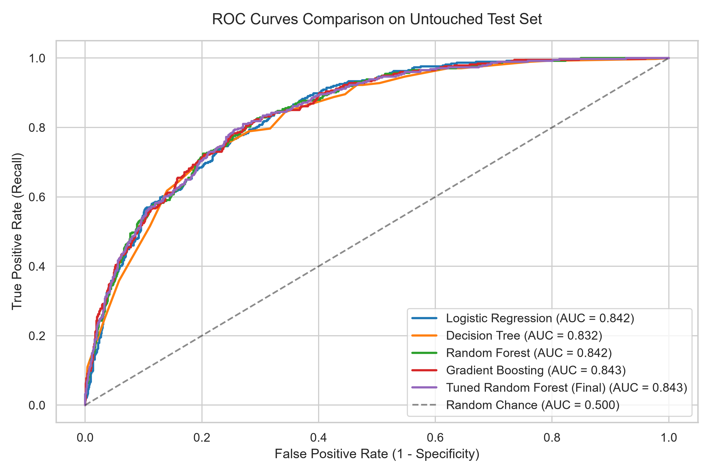

# Telco Customer Churn Prediction

[](https://www.python.org/)
[](https://scikit-learn.org/)
[](LICENSE)

A machine learning project that predicts which telecom customers are likely to cancel their subscription, using the IBM Telco Customer Churn dataset. I compared four models with cross-validation, tuned the best one, chose a decision threshold, and built a Streamlit app to try it out.

**Live demo:** https://customer-churn-prediction-hq4dza7sdg8haiip4pqjbd.streamlit.app

---

## Project Overview

Telecom companies lose money when customers cancel, and keeping a customer is usually cheaper than finding a new one. The goal of this project is to flag customers who are likely to churn so that a retention team can reach out early.

Missing a customer who is about to leave (a false negative) is worse than contacting someone who would have stayed (a false positive). Because of this, I focused on **recall** for the churn class, while also tracking F1-score and ROC-AUC.

## Dataset

- **Source:** IBM Telco Customer Churn (`WA_Fn-UseC_-Telco-Customer-Churn.csv`)
- **Size:** 7,043 customers, 21 columns
- **Target:** `Churn` (Yes = 1, No = 0)
- **Class balance:** 5,174 stayed (73.46%) and 1,869 churned (26.54%)

## Approach

**Data cleaning**
- Dropped `customerID`, since it is just an identifier.
- `TotalCharges` had 11 blank values. All 11 customers had `tenure = 0` (brand-new accounts), so I filled them with `0.0`.
- Converted `SeniorCitizen` from 0/1 to No/Yes so it is treated like the other categorical columns.

**Preprocessing and avoiding data leakage**
- Split the data first: 80% train (5,634 rows) and 20% test (1,409 rows), stratified on `Churn`, `random_state=42`.
- Used a scikit-learn `Pipeline` with a `ColumnTransformer` (`StandardScaler` for numeric columns, `OneHotEncoder` for categorical columns), so the scaling and encoding are fitted on training data only.
- The test set was used only once, at the very end.

**Handling class imbalance**
- Used `class_weight='balanced'` instead of oversampling.

**Models compared (5-fold stratified cross-validation on the training set)**
- Logistic Regression, Decision Tree, Random Forest, Gradient Boosting

**Tuning**
- Tuned the Random Forest with `GridSearchCV` (scoring on F1).
- Best parameters: `n_estimators=200`, `max_depth=10`, `min_samples_split=5`, `min_samples_leaf=4`.

**Decision threshold**
- Checked precision, recall and F1 at different cut-offs using out-of-fold predictions on the training set. The best F1 was at **0.50**.

## Results

Final scores on the untouched test set (1,409 customers):

| Model | Accuracy | Precision | Recall | F1-Score | ROC-AUC |
| :--- | :---: | :---: | :---: | :---: | :---: |
| **Tuned Random Forest (final)** | 0.7580 | 0.5298 | 0.7834 | 0.6321 | 0.8425 |
| Random Forest (base) | 0.7502 | 0.5196 | 0.7807 | 0.6239 | 0.8420 |
| Decision Tree | 0.7544 | 0.5260 | 0.7567 | 0.6206 | 0.8318 |
| Logistic Regression | 0.7381 | 0.5043 | 0.7834 | 0.6136 | 0.8415 |
| Gradient Boosting | 0.8027 | 0.6655 | 0.5160 | 0.5813 | 0.8433 |

The final model catches about 78% of the customers who actually churned (293 out of 374).

Gradient Boosting has the best accuracy and precision, but its recall is much lower because I did not use class weights for it. That is why I did not pick it as the final model.




Lowering the threshold below 0.50 catches more churners but also flags more customers who would have stayed:


## Key Insights


- **Contract type:** month-to-month customers churn at 42.7%, compared to 11.3% for one-year and 2.8% for two-year contracts.
- **Tenure:** churn is highest among new customers. Customers with 5 months or less churn at about 54%, while customers with more than 20 months churn at about 15%.
- **Internet service:** fiber optic customers churn at 41.9%, compared to 19.0% for DSL.
- **Payment method:** electronic check users churn at 45.3%, compared to 15.2% for credit card (automatic) and 16.7% for bank transfer (automatic).
- **Tech support:** customers without tech support churn at 41.6%, compared to 15.2% for those who have it.

The most important features in the final Random Forest were `tenure`, `Contract_Month-to-month`, `TotalCharges`, `Contract_Two year` and `MonthlyCharges`.


## Retention Ideas

*Note: Specific offers (discount %, bill credits) are illustrative ideas, not derived from the data. Churn-rate figures come from the dataset.*

- Encourage month-to-month customers to move to longer contracts, for example with a discount.
- Check in with new customers during their first few months.
- Look into fiber optic pricing and service quality, and consider bundling tech support.
- Encourage automatic payments instead of electronic checks.

## Streamlit App

`app.py` is a small web app where you enter a customer's details and get a churn probability and a risk level:

- **Low risk:** below 35%
- **Medium / borderline:** 35% to 50%
- **High risk:** 50% or above

It also shows a few suggested retention actions based on the customer's profile. The sidebar metrics are the test-set results from the notebook.

Run it locally:

```bash
pip install -r requirements.txt
streamlit run app.py
```

## Using the Saved Model

```python
import joblib
import pandas as pd

pipeline = joblib.load('models/churn_model.joblib')

customer = {
    'gender': 'Female', 'SeniorCitizen': 'Yes', 'Partner': 'No', 'Dependents': 'No',
    'tenure': 2, 'PhoneService': 'Yes', 'MultipleLines': 'No',
    'InternetService': 'Fiber optic', 'OnlineSecurity': 'No', 'OnlineBackup': 'No',
    'DeviceProtection': 'No', 'TechSupport': 'No', 'StreamingTV': 'Yes',
    'StreamingMovies': 'Yes', 'Contract': 'Month-to-month', 'PaperlessBilling': 'Yes',
    'PaymentMethod': 'Electronic check', 'MonthlyCharges': 95.50, 'TotalCharges': 191.00
}

probability = pipeline.predict_proba(pd.DataFrame([customer]))[0, 1]
print(f"Churn Probability: {probability:.1%}")
# Output: Churn Probability: 90.9%
```

## Repository Structure

```
customer-churn-prediction/
├── data/
│   └── raw/
│       └── WA_Fn-UseC_-Telco-Customer-Churn.csv
├── models/
│   └── churn_model.joblib
├── notebooks/
│   └── churn_prediction.ipynb
├── reports/
│   └── figures/
├── app.py
├── requirements.txt
├── LICENSE
└── README.md
```

## How to Run

```bash
git clone https://github.com/attadabhuvanteja-cyber/customer-churn-prediction.git
cd customer-churn-prediction

python -m venv venv
# Windows:
venv\Scripts\activate
# macOS / Linux:
source venv/bin/activate

pip install -r requirements.txt
jupyter notebook notebooks/churn_prediction.ipynb
```

The pinned versions in `requirements.txt` match the ones used to train and save the model, so keep them if you want to load `churn_model.joblib`.

## Tech Stack

Python, pandas, numpy, matplotlib, seaborn, scikit-learn, joblib, Streamlit

## Limitations and Future Work

- The dataset is small (7,043 customers) and comes from a single source, so results may not carry over to other telecom data.
- The retention ideas are general suggestions and have not been tested on real customers.
- Possible next steps: weight customers by their value, try survival analysis to estimate *when* a customer might leave, and test other models such as XGBoost.

## What I Learned

<!-- edit in your own words -->
- Why the train/test split should happen before any preprocessing, and how a `Pipeline` helps avoid data leakage.
- How class imbalance affects metrics, and why accuracy alone can be misleading.
- How cross-validation and `GridSearchCV` are used to compare and tune models without touching the test set.
- How changing the decision threshold trades precision for recall.

## License

This project is available under the [MIT License](LICENSE).
