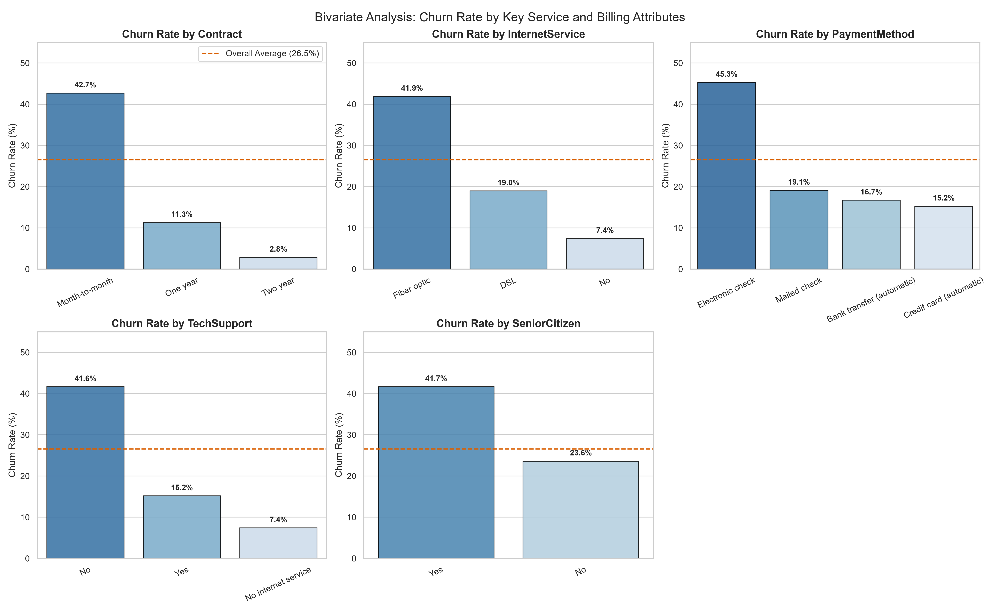
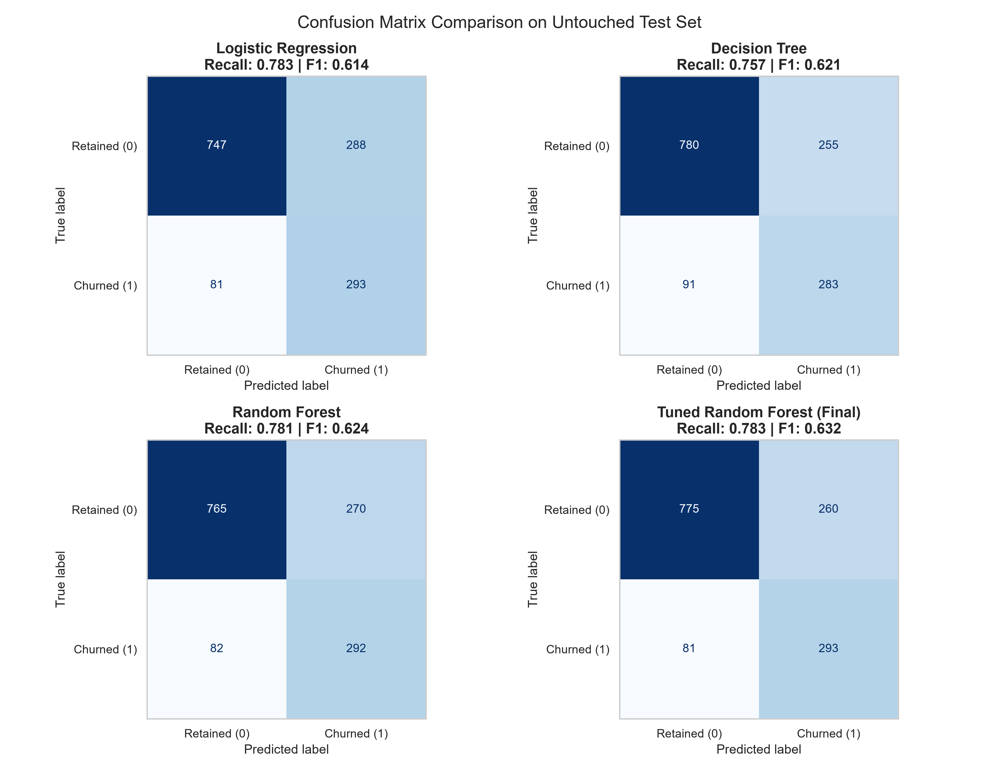
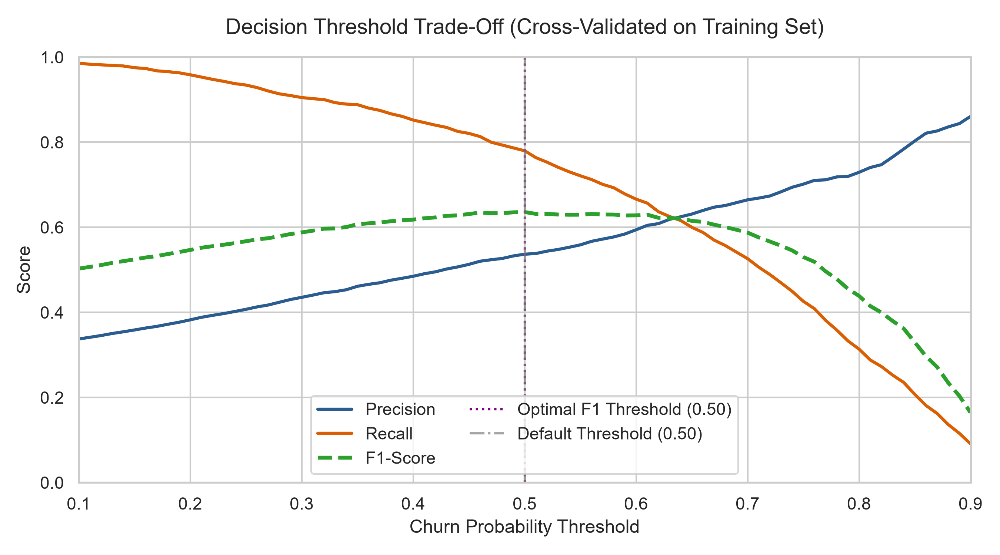
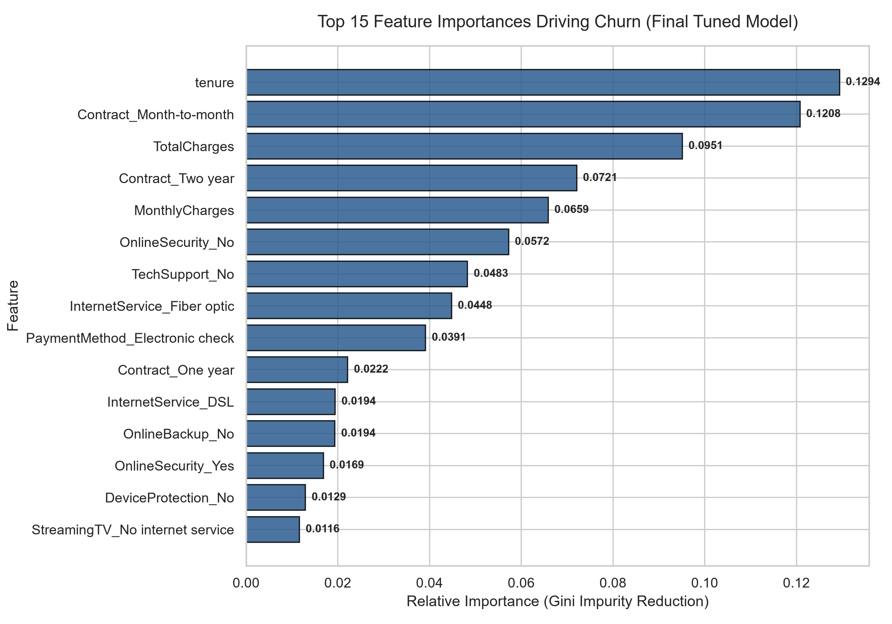

# 📊 Telco Customer Churn Prediction: An End-to-End Machine Learning System

[](https://www.python.org/)
[](https://scikit-learn.org/)
[](LICENSE)
[]()

> A production-grade, portfolio-ready customer churn prediction project applying industry-standard machine learning workflows to the IBM Telco dataset. Designed with **zero data leakage**, rigorous **5-fold stratified cross-validation on the training set**, **hyperparameter tuning**, **cross-validated decision threshold optimization**, and **quantifiable business retention strategies**.

---
## 🚀 Live Demo
Try the app here: https://customer-churn-prediction-hq4dza7sdg8haiip4pqjbd.streamlit.app

## 📑 Table of Contents
- [Business Problem & Financial Impact](#-business-problem--financial-impact)
- [Dataset Architecture](#-dataset-architecture)
- [Methodology & Leakage Prevention](#-methodology--leakage-prevention)
- [Key Exploratory Data Analysis Insights](#-key-exploratory-data-analysis-insights)
- [Machine Learning Model Comparison](#-machine-learning-model-comparison)
- [Winning Model & Hyperparameter Tuning](#-winning-model--hyperparameter-tuning)
- [Decision Threshold Optimization](#-decision-threshold-optimization)
- [Feature Importance & Key Churn Drivers](#-feature-importance--key-churn-drivers)
- [Actionable Business Recommendations](#-actionable-business-recommendations)
- [Repository Structure](#-repository-structure)
- [How to Run (Local & Google Colab)](#-how-to-run-local--google-colab)
- [Tech Stack](#-tech-stack)
- [Limitations & Future Roadmap](#-limitations--future-roadmap)

---

## 🎯 Business Problem & Financial Impact

### The Challenge
In telecommunications, **customer churn** represents subscribers canceling or discontinuing their recurring services. Because telecom infrastructure operates with high fixed operating costs, subscriber retention directly governs operating margins and shareholder value.

### Financial Asymmetry
* **Customer Acquisition Cost (CAC)**: Acquiring a new customer costs **5 to 7 times more** than retaining an existing customer.
* **Cost of Misclassification**:
  * **False Negative (Type II Error - Severe)**: Predicting a customer will stay when they actually churn. The customer leaves unaddressed, resulting in a **100% loss of customer lifetime value (LTV)**.
  * **False Positive (Type I Error - Moderate)**: Predicting a customer will churn when they intend to stay. The firm incurs a modest operational retention cost (e.g., offering a discount or loyalty perk).

**Objective**: Build a predictive machine learning system prioritizing **Recall** and **F1-Score / ROC-AUC** for the churn class, ensuring high capture of at-risk subscribers while optimizing marketing intervention budgets.

---

## 📂 Dataset Architecture

* **Source**: IBM Telco Customer Churn (`WA_Fn-UseC_-Telco-Customer-Churn.csv`)
* **Volume**: 7,043 customers, 21 initial attributes
* **Target Variable**: `Churn` (`Yes` = 1, `No` = 0)
* **Prevalence**: 
  * **Retained (No)**: 5,174 customers (**73.46%**)
  * **Churned (Yes)**: 1,869 customers (**26.54%**)
  * *Class Imbalance*: ~73.5% / 26.5%

### Data Cleaning Decisions
1. **`customerID` Dropped**: Identifier column containing 7,043 unique alphanumeric strings with zero generalizable predictive signal.
2. **`TotalCharges` Whitespace Handling**: 11 records contained blank string spaces (`" "`). Analysis confirmed that all 11 rows had `tenure == 0` (brand-new accounts enrolled in the current billing cycle with no prior billing cycle). These were converted to `0.0` with clear domain justification.
3. **`SeniorCitizen` Formatting**: Converted `0/1` integers to categorical labels (`"No"` / `"Yes"`) to support intuitive visualization and uniform pipeline encoding.
4. **Target Encoding**: `Churn` mapped to binary integers (`Yes` -> 1, `No` -> 0).

---

## 🛡️ Methodology & Leakage Prevention

To guarantee genuine generalization and eliminate optimistic performance bias:
1. **Stratified Split FIRST**: The dataset was split into an **80% Training Set (5,634 samples)** and a **20% Untouched Test Set (1,409 samples)** with target stratification on `Churn` (`random_state=42`).
2. **Pipeline Encapsulation**: All scaling and one-hot encoding are isolated within a `ColumnTransformer` inside Scikit-learn `Pipeline` objects. The transformers are fitted **strictly on training folds** and only applied (transformed) to test/validation folds.
3. **Zero Test-Set Peeking**: In accordance with enterprise best practices:
   * **Model comparison** was conducted via **5-fold Stratified Cross-Validation on the training set only**.
   * **Hyperparameter tuning** was performed using `GridSearchCV` on the training set.
   * **Decision threshold selection** was executed using out-of-fold `cross_val_predict` on the training set.
   * The **test set was evaluated only once**, after all models, parameters, and thresholds were permanently locked.

```
Raw Data (7,043)
       │
       ▼
Stratified Train/Test Split (80/20, random_state=42)
       ├── Training Set (5,634) ──> 5-Fold Stratified CV ──> Model Selection (RF & LR)
       │                                                 ──> GridSearchCV Tuning
       │                                                 ──> CV Threshold Optimization
       │
       └── Untouched Test Set (1,409) ────────────────────> Final One-Time Evaluation
```

---

## 📈 Key Exploratory Data Analysis Insights



1. **Contract Structure is the Single Strongest Churn Driver**:
   * **Month-to-month contracts**: **42.7% churn rate**
   * **One-year contracts**: **11.3% churn rate**
   * **Two-year contracts**: **2.8% churn rate**
   * *Takeaway*: Eliminating month-to-month friction via multi-month or annual onboarding incentives is the highest-leverage retention strategy.
2. **Early Tenure Vulnerability ("The Onboarding Cliff")**:
   * Churn is intensely concentrated during the **first 1 to 5 months** of tenure. Customers who cross the 20-month threshold show exponential loyalty gains.
3. **Fiber Optic Service Dissatisfaction**:
   * Fiber optic users experience a **41.9% churn rate**, vs. **19.0% for DSL** and **7.4% for no internet service**. High monthly fees ($70–$100) paired with potential connection instability trigger cancellations.
4. **Electronic Check Friction**:
   * Customers paying with **Electronic Check churn at 45.3%**, compared to **15.2% for automated Credit Card** and **16.7% for automated Bank Transfer**. Non-automated payment methods create recurring points of customer drop-off.
5. **TechSupport and Security as Retention Anchors**:
   * Customers lacking **TechSupport churn at 41.6%**, while customers with active TechSupport churn at only **15.2%**.

---

## 🤖 Machine Learning Model Comparison

All models were evaluated using **5-Fold Stratified Cross-Validation on the Training Set ONLY** using `class_weight='balanced'` where applicable:

### 5-Fold Cross-Validation Benchmark (Training Set Only)
| Model | CV Recall | CV F1-Score | CV ROC-AUC | CV Precision | CV Accuracy |
| :--- | :---: | :---: | :---: | :---: | :---: |
| **Random Forest (Base)** | **0.7973 ± 0.0207** | **0.6352 ± 0.0150** | **0.8467 ± 0.0100** | 0.5282 ± 0.0181 | 0.7568 ± 0.0135 |
| **Logistic Regression** | 0.8013 ± 0.0379 | 0.6282 ± 0.0231 | 0.8460 ± 0.0124 | 0.5169 ± 0.0187 | 0.7485 ± 0.0151 |
| **Decision Tree** | 0.7773 ± 0.0312 | 0.6152 ± 0.0099 | 0.8275 ± 0.0127 | 0.5097 ± 0.0120 | 0.7421 ± 0.0089 |
| **Gradient Boosting** | 0.5291 ± 0.0305 | 0.5880 ± 0.0296 | 0.8482 ± 0.0126 | 0.6622 ± 0.0338 | 0.8033 ± 0.0135 |

> *Note: Models were selected based on CV F1-Score and CV Recall on the minority churn class. Random Forest and Logistic Regression provided the most robust baseline balance.*

---

## 🏆 Winning Model & Hyperparameter Tuning

We tuned the **Random Forest Pipeline** via `GridSearchCV` (5-fold stratified CV on `X_train`) optimizing for `f1`:
* **Parameter Grid Searched**:
  * `classifier__n_estimators`: `[100, 200]`
  * `classifier__max_depth`: `[6, 8, 10]`
  * `classifier__min_samples_split`: `[5, 10]`
  * `classifier__min_samples_leaf`: `[2, 4]`
* **Best Hyperparameters**:
  * `max_depth`: 10
  * `min_samples_leaf`: 4
  * `min_samples_split`: 5
  * `n_estimators`: 200
* **Best CV F1-Score**: **0.6360**

### Final Evaluation on Untouched Test Set (1,409 Customers)
*Evaluated only once after models, hyperparameters, and decision thresholds were locked:*

| Model | Accuracy | Precision | Recall | F1-Score | ROC-AUC | Selection Method |
| :--- | :---: | :---: | :---: | :---: | :---: | :---: |
| 🥇 **Tuned Random Forest (Final)** | **0.7580** | **0.5298** | **0.7834** | **0.6321** | **0.8425** | **CV Selection & Tuned** |
| Random Forest (Base) | 0.7502 | 0.5196 | 0.7807 | 0.6239 | 0.8420 | 5-Fold CV Baseline |
| Decision Tree | 0.7544 | 0.5260 | 0.7567 | 0.6206 | 0.8318 | 5-Fold CV Baseline |
| Logistic Regression | 0.7381 | 0.5043 | 0.7834 | 0.6136 | 0.8415 | 5-Fold CV Baseline |
| Gradient Boosting | 0.8027 | 0.6655 | 0.5160 | 0.5813 | 0.8433 | 5-Fold CV Baseline |

### Diagnostic Performance Visualizations



* **Recall**: The tuned final model captures **78.34% of all actual churners** (293 out of 374 in the test set).
* **ROC-AUC**: **0.8425**, demonstrating superior discrimination capability across diverse probability thresholds.

---

## 🎯 Decision Threshold Optimization



Using out-of-fold `cross_val_predict` on the training set, we evaluated precision, recall, and F1 across probability cutoffs:
* **F1-Optimal Threshold**: **0.50** (Precision = 0.537, Recall = 0.780, F1 = 0.636).
* **High-Recall Operational Threshold (0.35–0.40)**:
  * In scenarios where customer acquisition cost is extremely high, reducing the threshold to **0.40** increases recall to **>84%**, ensuring almost no at-risk customer leaves unnoticed, at the expense of a modest increase in outreach calls.

---

## 🔍 Feature Importance & Key Churn Drivers



Top features extracted from the final production pipeline:
1. **`tenure`** (0.1294): Length of customer relationship is the single most powerful stabilizing force.
2. **`Contract_Month-to-month`** (0.1208): Strongest churn risk indicator.
3. **`TotalCharges`** (0.0951): Reflects total investment and customer life stage.
4. **`Contract_Two year`** (0.0721): Strongest loyalty anchor.
5. **`MonthlyCharges`** (0.0659): Price sensitivity indicator.
6. **`OnlineSecurity_No`** (0.0572) & **`TechSupport_No`** (0.0483): Lack of value-added support accelerates attrition.
7. **`InternetService_Fiber optic`** (0.0448): High price-point dissatisfaction.
8. **`PaymentMethod_Electronic check`** (0.0391): High-friction billing method.

---

## 💡 Actionable Business Recommendations

1. **Incentivize Upgrades from Month-to-Month Contracts**:
   * *Evidence*: Month-to-month churn is **42.7%** vs. **2.8%** for two-year plans.
   * *Action*: Offer high-risk month-to-month subscribers a 15% discount for the first 3 months or free streaming service credits upon upgrading to an annual contract.
2. **Deploy a 'First-90-Days' High-Touch Onboarding Journey**:
   * *Evidence*: Churn peaks in months 1–5; tenure is the #1 model feature.
   * *Action*: Trigger automated check-ins at Day 14, 30, and 60. Offer dedicated concierge support during initial router setup.
3. **Audit Fiber Optic Pricing and Network Reliability**:
   * *Evidence*: Fiber optic churn is **41.9%**, and Monthly Charges is a top feature.
   * *Action*: Audit local node stability for fiber customers and bundle complimentary TechSupport to eliminate the price-to-value deficit.
4. **Incentivize Autopay Adoption**:
   * *Evidence*: Electronic check users churn at **45.3%** vs. **~15%** for Credit Card / Bank Transfer.
   * *Action*: Provide a recurring \$5 monthly bill credit for switching from electronic check to automated bank transfer or credit card autopay.
5. **Bundle TechSupport into Standard Offerings**:
   * *Evidence*: Customers without TechSupport churn at **41.6%** vs. **15.2%** for supported users.
   * *Action*: Provide 6 months of complimentary TechSupport to all high-risk accounts.

---

## 💻 Standalone Inference Example

The serialized model (`models/churn_model.joblib`) includes all preprocessing and can be queried directly:

```python
import joblib
import pandas as pd

# Load pipeline
pipeline = joblib.load('models/churn_model.joblib')

# New customer profile
customer = {
    'gender': 'Female',
    'SeniorCitizen': 'Yes',
    'Partner': 'No',
    'Dependents': 'No',
    'tenure': 2,
    'PhoneService': 'Yes',
    'MultipleLines': 'No',
    'InternetService': 'Fiber optic',
    'OnlineSecurity': 'No',
    'OnlineBackup': 'No',
    'DeviceProtection': 'No',
    'TechSupport': 'No',
    'StreamingTV': 'Yes',
    'StreamingMovies': 'Yes',
    'Contract': 'Month-to-month',
    'PaperlessBilling': 'Yes',
    'PaymentMethod': 'Electronic check',
    'MonthlyCharges': 95.50,
    'TotalCharges': 191.00
}

df_input = pd.DataFrame([customer])
probability = pipeline.predict_proba(df_input)[0, 1]

print(f"Churn Probability: {probability:.1%}")
# Output: Churn Probability: 91.0% (Critical Risk)
```

---

---

## 🌐 Interactive Streamlit Web App (`app.py`)

A full interactive web application is included to allow retention and customer success teams to simulate customer churn risk in real-time.

### Key Features:
* **Interactive Sliders & Dropdowns**: Configure any customer's tenure, billing method, contract type, and subscription services using the exact categories from the dataset.
* **Direct Pipeline Ingestion**: The input profile is fed directly into the serialized production pipeline (`models/churn_model.joblib`), executing the fitted scaling and encoding automatically.
* **Risk Categorization**:
  * **Low Risk (< 35%)**: Green badge; regular relationship maintenance.
  * **Medium / Borderline (35% – 50%)**: Amber badge; proactive monitoring and low-cost retention touches.
  * **High Risk (≥ 50%)**: Red badge; immediate intervention required.
* **Dynamic Action Plan**: Generates plain-language, personalized business recommendations tailored specifically to the customer's risk factors (e.g., month-to-month upgrade incentive, electronic check autopay credit, complimentary TechSupport bundle).

### How to Run the App Locally:
```bash
# Ensure dependencies are installed
pip install -r requirements.txt

# Launch the Streamlit application
streamlit run app.py
```
Open `http://localhost:8501` in your browser.

---

## ☁️ Deploying to Streamlit Community Cloud (Step-by-Step)

You can deploy this application for free to share a live URL on your portfolio and LinkedIn:

1. **Push to GitHub**:
   * Commit and push your code to a public GitHub repository:
   ```bash
   git add .
   git commit -m "feat: complete customer churn prediction system and streamlit app"
   git push origin main
   ```
2. **Sign in to Streamlit Cloud**:
   * Visit [share.streamlit.io](https://share.streamlit.io/) and log in using your GitHub account.
3. **Deploy New App**:
   * Click **"Create app"** (or **"New app"**).
   * Select **"I already have an app"**.
   * Choose your repository: `your-username/customer-churn-prediction`.
   * Set **Branch**: `main`.
   * Set **Main file path**: `app.py`.
   * Set **App URL**: choose an optional custom subdomain (e.g., `telco-churn-predictor.streamlit.app`).
4. **Deploy**:
   * Click **"Deploy!"**.
   * Streamlit Community Cloud will automatically detect `requirements.txt`, install all pinned dependencies (`scikit-learn==1.9.1`, `pandas==3.0.6`, `numpy==2.5.3`, `streamlit>=1.30.0`), load `models/churn_model.joblib`, and launch your live application.

## 📁 Repository Structure

```
churn-prediction/
├── data/
│   └── raw/
│       └── WA_Fn-UseC_-Telco-Customer-Churn.csv   # Raw IBM Telco dataset
├── notebooks/
│   └── churn_prediction.ipynb                     # Complete narrative Jupyter notebook
├── models/
│   └── churn_model.joblib                         # Persisted production-ready pipeline
├── reports/
│   └── figures/                                   # High-resolution exported figures
│       ├── churn_by_categorical_features.png
│       ├── churn_distribution.png
│       ├── confusion_matrices_comparison.png
│       ├── feature_importance.png
│       ├── numerical_distributions_by_churn.png
│       ├── numeric_correlation_heatmap.png
│       ├── roc_curves_comparison.png
│       └── threshold_tradeoff.png
├── scripts/                                       # Modular generation & execution scripts
├── requirements.txt                               # Project dependencies
├── README.md                                      # Project documentation & business report
└── .gitignore                                     # Standard git ignore rules
```

---

## 🚀 How to Run

### 1. Local Environment Setup
```bash
# Clone repository
git clone https://github.com/your-username/customer-churn-prediction.git
cd customer-churn-prediction

# Create and activate virtual environment
python -m venv venv
# On Windows:
venv\Scriptsctivate
# On macOS/Linux:
source venv/bin/activate

# Install dependencies
pip install -r requirements.txt

# Launch Jupyter Notebook
jupyter notebook notebooks/churn_prediction.ipynb
```

### 2. Google Colab Execution
1. Open [Google Colab](https://colab.research.google.com/).
2. Upload `notebooks/churn_prediction.ipynb`.
3. Upload `WA_Fn-UseC_-Telco-Customer-Churn.csv` into the session root or `data/raw/` (the notebook dynamically detects both paths).
4. Run all cells from `Runtime > Run all`.

---

## 🛠️ Tech Stack
* **Language**: Python 3.10+
* **Data Processing**: `pandas`, `numpy`
* **Data Visualization**: `matplotlib`, `seaborn`
* **Machine Learning**: `scikit-learn` (`Pipeline`, `ColumnTransformer`, `StandardScaler`, `OneHotEncoder`, `RandomForestClassifier`, `LogisticRegression`, `GridSearchCV`, `cross_validate`)
* **Serialization**: `joblib`
* **Notebook Tooling**: `ipykernel`, `nbformat`, `nbclient`

---

## 🔮 Limitations & Future Roadmap

* **Cohort Survival Analysis**: Incorporating Kaplan-Meier and Cox Proportional Hazards models to estimate *when* a customer will churn rather than just binary probability.
* **Customer Lifetime Value (LTV) Weighting**: Modifying the objective function so the model prioritizes high-revenue churners over low-margin accounts.
* **Interactive Dashboard**: Deploying an interactive **Streamlit web application** (`app.py`) allowing retention agents to run what-if simulation scenarios on live customer accounts.

---

## 📄 License
This project is open-source and available under the [MIT License](LICENSE).
